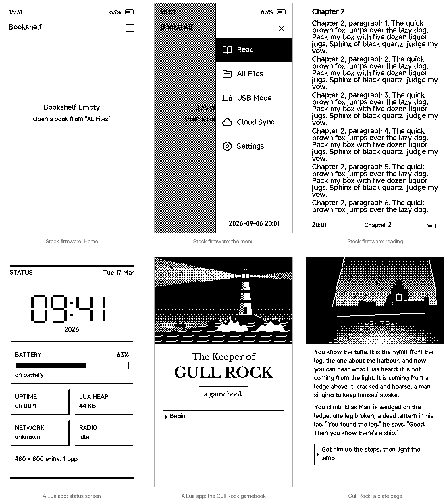
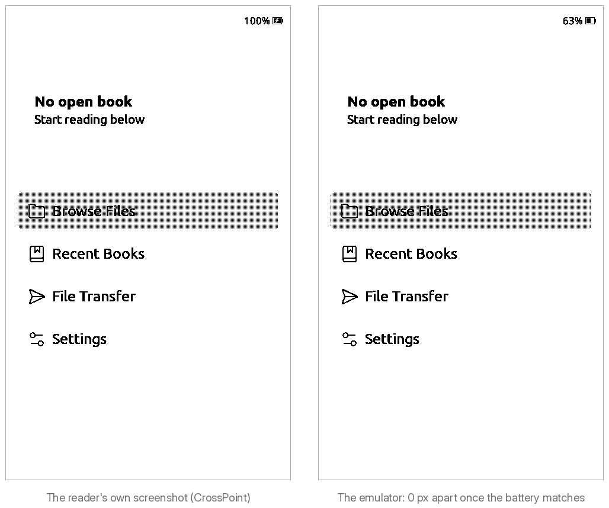
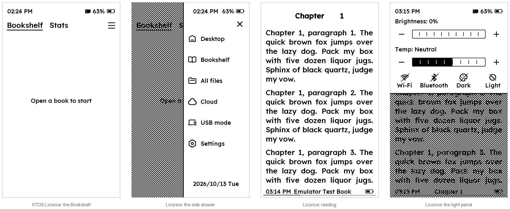
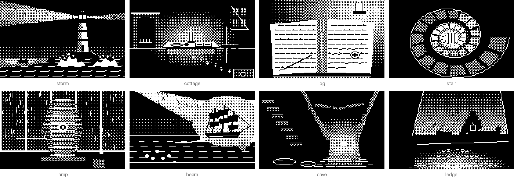

# x4pro-emu

[](https://github.com/kycube/x4pro-emu/actions/workflows/ci.yml)

An emulator for the **Xteink X4 Pro** e-reader (ESP32-S3, 800 × 480 e-paper, GT911 touch, front light),
built on Espressif's QEMU. It runs **unmodified firmware images** — the stock `xteink_app` (7.2.4
through 7.6.8), the stock's new XTOS Licorice generation and the open-source [CrossPoint Reader](https://github.com/crosspoint-reader/crosspoint-reader)
— and you drive it from a shell, a test, or an AI agent: press the buttons, tap and swipe the
screen, read the console, screenshot the panel, query the whole device as JSON.



<sub>Every screen above is a test golden: the emulator drew it, and `make test` compares it again on every run.</sub>

## What you can do with it

- **Run the real firmware.** The stock app boots to Home, opens and pages books, runs its menu,
  light panel and settings, fades its front light, and its WiFi start comes up and stops itself
  cleanly. CrossPoint 1.6 boots, reads, sleeps and wakes. The stock's rewrite, XTOS Licorice (builds
  261013 and 26102901), reads books, drives its front light, toggles Wi-Fi and Bluetooth, sleeps and wakes,
  enters its USB disk mode, and installs and runs mini apps ([docs/stock-licorice.md](docs/stock-licorice.md)).
  A raw 16 MB flash dump runs as it comes off the device; so does a fresh build.
- **Drive it like a device.** `x4emu tap`, `swipe`, `press`, `hold`, `chord`, `home`, `battery`,
  `light`, `screenshot --diff`, `wait-text`, `wait-refresh`, `state` — every command can print JSON.
  Inputs are journaled and replayable against guest time (`record` / `replay`, deterministic mode),
  and `watch` serves a live view of the panel in a browser.
- **Let an agent drive it.** `.mcp.json` registers an MCP server with the same tools (boot, tap,
  screenshot inline, state, console, build and flash helpers), so Claude Code can iterate on firmware
  against the emulator by itself.
- **Change the stock firmware without its source.** Version-aware tools for the stock 7.x app:
  named byte patches (the developer menu with Screen Capture, hidden menu rows, the Mini Apps row),
  UI string editing in all of its languages, system fonts built from any TrueType file, the `.xic`
  screen-capture format, and a one-minute Ghidra analysis of each version (Licorice included; the
  patch and string tools refuse Licorice, a rewrite without those sites).
- **Write apps for the stock firmware.** The stock app hosts **Lua apps** — on 7.5.4–7.6.8 straight
  from the SD card with no firmware change, on XTOS Licorice as signed packages `tools/xtapp.py`
  builds. The repo maps that API, measures its limits, and ships status screens and a gamebook toolkit
  (below).
- **Work with the real device safely.** `tools/device.py` backs up, inspects and restores the reader
  over USB, refuses to write anything below the app slots, and checks which slot the bootloader
  really starts before it writes one.

## Quick start

macOS or Linux; paths must not contain spaces.

```bash
make setup      # Python venv, Espressif QEMU at a pinned commit + qemu-patches/, CrossPoint submodule
make build      # qemu-system-xtensa, the panel models, CrossPoint's x4pro image
make test       # model unit tests, fixture replays, ~270 pytest cases on parallel workers (~2 min)
```

Packages: git, ninja, meson, pkg-config, glib, pixman, libgcrypt, libslirp, libpng, mtools,
dosfstools, python3, and a Python 3.10–3.14 for PlatformIO (`make` installs it into `.venv-pio`).
Then boot CrossPoint and take a screenshot:

```bash
.venv/bin/python tools/mkflash.py images/flash.bin --build firmware/.pio/build/x4pro
.venv/bin/python tools/mksd.py images/sd.img --size 256M --src path/to/books
tools/x4emu run --flash images/flash.bin --sd images/sd.img --fast-epd
tools/x4emu wait-text "Entering activity: Home" --timeout 60
tools/x4emu screenshot home.png
tools/x4emu --json state
```

The stock firmware is Xteink's and is not in this repository: it runs from your own device's flash
dump (`tools/device.py backup`), which stays in the gitignored `images/` because it holds your WiFi
credentials. [CLAUDE.md](CLAUDE.md) has the stock boot recipe, [docs/x4emu.md](docs/x4emu.md) every command.

## Faithful to the device



The models are checked against the desk unit, not just against datasheets:

- CrossPoint's Home, as the device screenshots itself, is reproduced with **0 differing pixels**,
  and two reader pages match outside the footer clock (`tests/test_device_screenshot.py`).
- The panel command stream recorded on the device replays through the panel core
  (`models/fixtures/`); boot, sleep and wake logs match the device's (`docs/device/`).
- The **UC8279** panel (the desk unit's; SSD1677 and UC8179 batches are modelled too) answers the
  firmware's identification probe as the real one does, refreshes with the device's measured BUSY
  times, and renders grey through a waveform-level model calibrated on a photo of the glass
  ([docs/grayscale.md](docs/grayscale.md)).
- The two emulated cores keep the chip's memory order on any host, an arm64 Mac included, and every
  input is held, in guest time, until the firmware has seen it and its release: no test retries inputs
  ([docs/smp.md](docs/smp.md), [docs/x4emu.md](docs/x4emu.md)).
- `tools/parity.py` runs the same steps on the emulator and, from a printed runbook, on the reader, and
  compares the stock's own Screen Captures pixel by pixel, every difference masked or explained
  ([docs/parity.md](docs/parity.md)). The first session on the reader (stock 7.6.8, 2026-10-13) passed:
  seven screens, from Home to a Lua gamebook, with 0 unexplained pixels (only the clock, the battery,
  the date and a saved game differ). The eighth, the light panel, closes before a capture is taken.
- Touch, buttons, the capacitive Home pad, the front light (LEDC with hardware fades), the battery
  gauge, the RTC, the SD card, deep sleep and the radio blocks a WiFi start touches are modelled to
  the point where both firmwares run unpatched ([docs/hardware.md](docs/hardware.md)).
- The stock's Lua apps keep their `ctx.state` between visits and across a reboot, as on the device:
  the firmware encrypts it with the SoC's AES accelerator through DMA, and the AES block is checked
  against a host AES in every block mode (`tests/test_aes.py`, `tests/test_lua_state.py`).

## XTOS Licorice, the stock's new generation



<sub>Licorice 261013, the screens the owner compared with the reader by eye. The device's current build,
26102901, has its own goldens (`tests/golden/licorice-v26102901-*.png`), not yet compared with the reader.</sub>

In October 2026 Xteink replaced the 7.x firmware with a rewrite, **XTOS Licorice**. The emulator runs it
from the device's own dump: the Bookshelf, the side drawer, the Desktop, All files and the reader, the
side buttons, the front light, Dark mode, Wi-Fi and Bluetooth toggles, sleep and wake, auto power-off
and USB mode (`tests/test_licorice.py`, `tests/test_usb_otg.py`). One panel-model fix was needed:
Licorice scans the panel the other way up from every earlier firmware. Its signed mini-app packages
install and run too (below). The build of 2026-10-29, **26102901** (a Recent tab on Home, "Ink App" for
mini apps), ran with no model change; every Licorice test runs on both builds. What changed, what runs and
what is still open: [docs/stock-licorice.md](docs/stock-licorice.md).

## Lua apps and a gamebook

The stock firmware (7.5.4 to 7.6.8) shows a **Mini Apps** row as soon as `/XTApps` on the card holds an app.
An app is a folder with a manifest and an `index.lua`; `tools/xtapp.py` packs and installs one. What the host
offers, and its hard limits (no file reads, a 1024-command frame cap, layers that have none), are in
[docs/lua-apps.md](docs/lua-apps.md).

XTOS Licorice installs apps from a signed `.xtapp` package instead. Its format is reverse-engineered in
[docs/licorice-apps.md](docs/licorice-apps.md): `tools/xtapp.py pack --format licorice` builds a package
its installer accepts, and the emulator takes it from All Files to the **"Installed"** confirmation
and on to running it: Mini Apps lists it, a tap launches it, it takes taps and leaves cleanly
(`tests/test_licorice_apps.py`, on 261013 and 26102901). Licorice's Lua host exposes more than 7.x's (a
`ctx.data` file API; TrueType text on 261013 only; not exercised yet), and its Mini Apps entry ("Ink App"
on 26102901) stays hidden until ten taps on Settings → About → "Model".

**The Keeper of Gull Rock** is a choose-your-own-adventure written and drawn for this project: 13
passages, five endings, and eight 1-bit pixel-art plates drawn in code. `tools/gamebook.py` builds it
from a plain-text story and a Python scene file into a single app folder; it has been played on the
real reader, where it keeps your place between visits. Write your own with
[docs/gamebook.md](docs/gamebook.md).



## What is not emulated

USB mass-storage traffic (the USB OTG core comes up and waits for a computer, but no computer sees the
disk), WiFi and Bluetooth traffic (the radio comes up, finds no air and stops), cycle timing (refresh
times are the device's measured ones; CPU speed is not), the electrical side of the GPIO matrix, RMT and
I2S. Deep sleep is a paused VM followed by a modelled reset. The details,
with what a firmware sees, are in [docs/hardware.md](docs/hardware.md#what-is-not-emulated-how-it-shows-up-for-a-firmware-developer).

## Documentation

| | |
|---|---|
| [CLAUDE.md](CLAUDE.md) | build and test, the stock boot recipe, the device rules, where things are — the entry point for people and agents alike |
| [docs/x4emu.md](docs/x4emu.md) | the `x4emu` CLI and its JSON shapes; installing it with pipx |
| [docs/hardware.md](docs/hardware.md) | the X4 Pro as the emulator models it, with sources; what is not emulated |
| [docs/lua-apps.md](docs/lua-apps.md) · [docs/licorice-apps.md](docs/licorice-apps.md) · [docs/gamebook.md](docs/gamebook.md) | writing apps for the stock firmware: 7.x's folder apps, Licorice's signed packages, gamebooks |
| [docs/stock-firmware.md](docs/stock-firmware.md) · [7.5.4](docs/stock-7.5.4.md) · [7.6.8](docs/stock-7.6.8.md) · [Licorice](docs/stock-licorice.md) | the stock app's internals, version by version, and its new generation |
| [docs/README.md](docs/README.md) | every other document, with a line each |
| [docs/smp.md](docs/smp.md) · [docs/heap.md](docs/heap.md) | two emulator-vs-firmware investigations: the two cores' memory order (an emulator bug, fixed) and a 7.2.4 heap corruption (the firmware's own race) |
| [docs/parity.md](docs/parity.md) | device parity: the same steps on the emulator and the reader, the stock's own Screen Captures compared pixel by pixel |
| [docs/upstream-qemu.md](docs/upstream-qemu.md) | the generic ESP32-S3 models split out for Espressif's QEMU: the series and the PR drafts, kept for a later day (not submitted) |
| [docs/upstream.md](docs/upstream.md) | the weekly upstream watch: new CrossPoint releases, Espressif QEMU, PlatformIO and Homebrew drift |
| [docs/log.md](docs/log.md) | the engineering log: what was done, what failed, and why |

## Repository layout

```
x4emu/          the CLI as a Python package (tools/x4emu is its in-repo shim)
qemu-patches/   our changes to Espressif's QEMU, applied by `make setup`
models/         pure-C panel cores (SSD1677, UC8179, UC8279) with host tests and device fixtures
tools/          flash/SD/efuse image builders, stock-firmware tools, the gamebook builder, device.py
apps/           Lua apps for the stock firmware;  stories/  gamebook sources;  parity/  device-parity scripts
tests/          pytest end-to-end and unit tests;  tests/golden/  the screens they hold
firmware/       CrossPoint Reader (submodule)
docs/           everything written down
```

## Licence

[MIT](LICENSE) for this repository's own work: the `x4emu` CLI, the panel models, the tools, the
Lua apps, and the gamebook's story and art. Three parts keep their own licences:

- `qemu-patches/` are changes to QEMU and are under QEMU's licence: the files they touch carry no
  header of their own, which QEMU's `LICENSE` makes GPL-2.0-or-later;
- `docs/device/idf-headers/` are Espressif's ESP-IDF register headers and ROM linker scripts,
  kept for reference (Apache-2.0);
- `firmware/` is [CrossPoint Reader](https://github.com/crosspoint-reader/crosspoint-reader), a
  submodule with its own MIT licence and copyright.

The stock firmware (`xteink_app` 7.x and XTOS Licorice) belongs to Xteink; it is not distributed here,
and the tools work on images you take from your own device.

## Credits

Built on [Espressif's QEMU fork](https://github.com/espressif/qemu) and
[CrossPoint Reader](https://github.com/crosspoint-reader/crosspoint-reader) with its freeink SDK.
The gamebook's display type is Libre Baskerville and the README captions Inter, both under the SIL
Open Font Licence (the fonts themselves are not in the repository).
